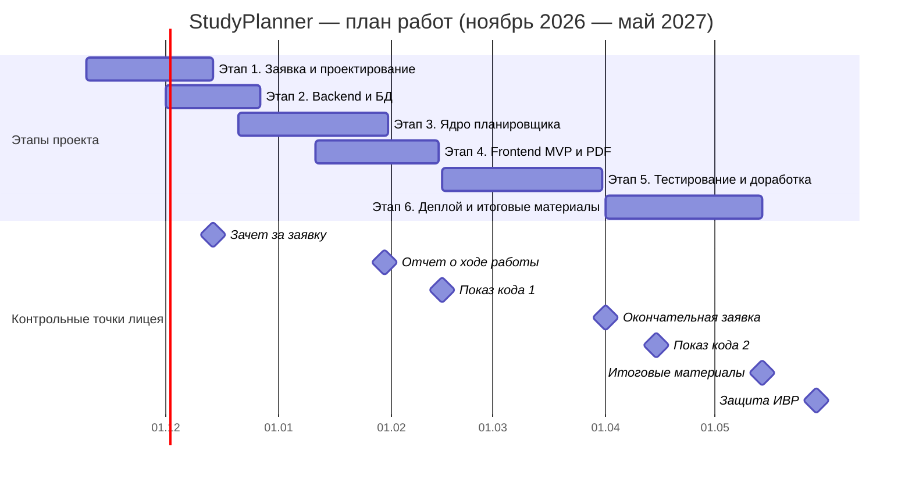

# Алина Лобастова - Веб-сервис планирования подготовки к экзаменам

### Группа: 10 - И - 4
### Электронная почта: allobastova@edu.hse.ru

## 1. — (индивидуальный проект)

## 2. Название проекта (ИВР)
«StudyPlanner»: Веб-сервис адаптивного планирования подготовки к экзаменам с синхронизацией данных между устройствами.

## 3. Тематическая область проекта
IT-проект

## 4. Целевая аудитория / заказчик
**Целевая аудитория:**
*   Учащиеся 8–11 классов лицеев и школ с углубленным изучением предметов, готовящиеся к ОГЭ, ЕГЭ, олимпиадам и контрольным работам.
*   Студенты первых курсов вузов, сталкивающиеся с необходимостью самостоятельного планирования семестра.

## 5. Проблемное поле
Ученики старших классов часто сталкиваются с проблемой хаотичной подготовки. Сейчас многие распределяют свое время интуитивно или вручную в тетради или Excel.

**Ключевые трудности и последствия:**
1.  **Сложность объективной оценки объема работы.** Ученик не знает заранее, сколько часов реально нужно на тему. Он выбирает темы по принципу «что страшнее», а не «что важнее». Это часто приводит к тому, что легкие темы занимают слишком много времени, а сложные остаются недоученными перед экзаменом.
2.  **Конфликт приоритетов при нескольких экзаменах.** Когда даты экзаменов пересекаются, ученик начинает прыгать между предметами, теряя фокус, или полностью забрасывает один предмет ради другого. Последствие — провал на заброшенном предмете и поверхностные знания на втором.
3.  **Хрупкость ручных планов.** Любое обстоятельство (болезнь, пропуск занятия, сложная тема) ломает весь график. Ученик видит отставание, паникует и бросает подготовку вовсе, переходя в режим ночной зубрежки.

Таким образом, проблема заключается в том, что пользователю сложно самостоятельно распределять ограниченное время между несколькими экзаменами и корректировать подготовку после пропусков: любой пропущенный день требует ручного пересчета всего графика, а необходимый объем часов по темам заранее неизвестен.

**Проверка проблемного поля:**
*   *Количественный опрос:* анкета примерно из 8-10 вопросов, выборка 5–10 одноклассников (при возможности — до 20). Предусмотрен блок о реальном опыте планирования: «Сколько экзаменов ты готовишь параллельно?», «Как сейчас распределяешь время?», «Что чаще всего ломает план?», «Что ты делаешь после пропуска дня подготовки?», «Бывало ли, что тема заняла больше времени, чем ожидалось?». Также планируется блок вопросов о конкретных случаях срыва планов и недооценки тем по времени.
*   *Калибровка:* отдельный блок анкеты — оценка сложности тем по шкале 1–5 и примерное число часов на тему.

## 6. Анализ аналогов

*   **[Notion](https://www.notion.com):** базы задач с датами; есть зависимости задач с [автоматическим сдвигом дат зависимых задач](https://www.notion.com/help/tasks-and-dependencies). Но сдвигаются даты, а не часы: сервис не оценивает трудоемкость тем и не делит недельный бюджет времени между несколькими экзаменами — перераспределение нагрузки после пропуска остается ручным.
*   **[Trello](https://trello.com):** канбан-доски; у карточек есть [сроки и напоминания](https://support.atlassian.com/trello/docs/adding-dates-to-cards/), есть календарное представление. Однако срок карточки не связан с оценкой часов: доска не показывает, помещается ли объем подготовки в оставшиеся дни, и не распределяет время между несколькими экзаменами.
*   **[Google Calendar](https://calendar.google.com):** блоки времени и напоминания. Но длительность блока пользователь назначает сам: сервис не оценивает, сколько часов нужно на конкретную тему, и не балансирует нагрузку между экзаменами при конфликте дат.
*   **[Anki](https://apps.ankiweb.net):** автоматически планирует повторения карточек по алгоритму интервальных повторений. Но планирование идет на уровне отдельных карточек, а не часов подготовки: Anki не знает о других экзаменах и не выделяет им долю общего бюджета времени.

**Вывод:** аналоги работают со сроками и напоминаниями, но не распределяют ограниченный запас времени между несколькими экзаменами по их сложности и срочности и не пересчитывает это распределение после пропусков в рамках заданного бюджета.

## 7. Образ продукта
Веб-сайт (Web Service), доступный через браузер на ПК и мобильных устройствах.

**Архитектура и технологии:**
*   **Backend:** Python, Flask (REST API).
*   **Frontend:** Vue 3 + Vite (SPA), Bootstrap 5.
*   **База данных:** PostgreSQL.
*   **ORM:** SQLAlchemy.

**Ключевые особенности алгоритма:**
Сервис работает по принципу распределения ограниченного ресурса времени. Программа принимает на вход общий запас времени пользователя и делит его между всеми задачами. Алгоритм основан на коэффициенте важности Ki. Он отражает срочность и трудоемкость подготовки к конкретному экзамену относительно других задач.

**Математическая модель расчета:**
Пусть у пользователя есть набор активных экзаменов E1, E2, ..., En. Для каждого экзамена задаются три параметра: вес важности Wi (вводится пользователем по шкале от 1 до 5, по умолчанию 3), средняя сложность его тем Ci (по шкале от 1 до 5) и близость даты Di (количество дней до экзамена, не менее 1).
Далее вычисляется показатель приоритета Pi = Wi · Ci / √Di. Он растет при увеличении важности и сложности и уменьшается при увеличении количества дней до дедлайна. Использование квадратного корня в знаменателе смягчает резкие скачки значимости при очень близких датах, предотвращая ситуацию, когда один экзамен полностью «съедает» время всех остальных предметов.
Чтобы получить доли времени, в сумме дающие единицу, алгоритм выполняет нормализацию. S — это сумма всех показателей приоритета, то есть S = P1 + P2 + ... + Pn. Тогда коэффициент важности рассчитывается по формуле Ki = Pi / S, а экзамен получает Ti = Ki · T часов, где T — заданный пользователем бюджет времени на период.

**Правила учета тем, текущих знаний и веса экзамена:**
*   *Вес экзамена Wi* задаётся пользователем и напрямую умножает приоритет: при равных сроках и сложности более важному экзамену достается большая доля времени.
*   *Сложность экзамена Ci* — средняя оценка сложности его тем. Каждую тему пользователь оценивает по шкале 1–5 и указывает текущий уровень понимания («не знаю» / «знаю частично» / «знаю хорошо»).
*   *Оценка необходимого времени на тему:* пользователь может задать свою оценку в часах; если оценки нет, применяется правило по умолчанию: базовое время = сложность темы в часах (1–5 ч), умноженная на коэффициент понимания («не знаю» — ×1,5; «знаю частично» — ×1; «знаю хорошо» — ×0,5).
*   *Распределение внутри экзамена:* часы Ti делятся между темами пропорционально оставшейся оценке необходимого времени — сложные и незнакомые темы получают больше часов, легкие и уже понятные — меньше.

**Правило предупреждения о нехватке времени:**
Суммарная оценка необходимого времени по темам каждого экзамена сравнивается с часами, которые бюджет реально позволяет выделить этому экзамену до его даты. Если потребность больше доступных часов, система выводит предупреждение с величиной дефицита в часах. После пропусков сравнение выполняется повторно.

**Функциональные требования:**
1.  **Регистрация и авторизация:** Создание аккаунта, вход/выход, изоляция данных пользователей.
2.  **Настройка нескольких задач:** Возможность создать несколько учебных событий (ЕГЭ, контрольная, олимпиада) с указанием дат и веса важности.
3.  **Структурирование:** Добавление тем к каждому событию с выбором типа (теория/практика/задачи).
4.  **Оценка уже имеющихся знаний:** Интерфейс для выставления сложности темы (по шкале 1–5) и текущего уровня понимания; эти данные участвуют в оценке необходимого времени и распределении часов.
5.  **Настройка ресурса времени:** Задание пользователем объема доступных часов в неделю.
6.  **Генерация плана:** Автоматическое построение расписания по дням до дат всех активных экзаменов в пределах заданного бюджета часов.
7.  **Трекер выполнения и пересчет:** Отметка задач как выполненных/пропущенных. При пропуске система переносит невыполненный объем на будущие дни и пересчитывает оставшуюся часть плана, не превышая заданный пользователем запас времени. Если пропущенные часы не помещаются в оставшийся бюджет, система не увеличивает лимит автоматически, а показывает предупреждение и предлагает варианты: увеличить бюджет, убрать часть тем или сократить время на уже знакомые темы.
8.  **Анализ рисков:** Визуализация общей готовности (доля выполненного объема) и предупреждения о нехватке времени. Предупреждение появляется по явному правилу: оценка необходимого времени по темам (оценка пользователя или значение по умолчанию из правила «сложность × уровень понимания») превышает часы, доступные до даты экзамена; в предупреждении указывается дефицит в часах.
9.  **Экспорт и синхронизация:** Скачивание плана в PDF и сохранение прогресса в облаке (PostgreSQL) для доступа с любого устройства.

## 8. Взаимодействие с другими людьми в рамках выполнения проекта
*   **Проектный руководитель:** Еженедельные консультации. Утверждение архитектуры, алгоритма распределения времени и контрольных точек, помощь в отладке сложных модулей.
*   **Учащиеся лицея (респонденты для анкетирования и интервью):**
    *   *Цель:* подтвердить проблемное поле (реальный опыт планирования, срывы планов, недооценка тем) и откалибровать шкалу сложности 1–5.
    *   *Формат:* анкета примерно из 12 вопросов (5–10 одноклассников) и мини-интервью с 3–5 респондентами (6–8 открытых вопросов). Результаты войдут в отчет о ходе работы и в калибровку коэффициентов расчета часов.
*   **Тестировщики:**
    *   *Роль:* В феврале 2027 года проводят тестирование. Их задача — пройти путь от регистрации до генерации плана, проверить сценарии пропуска дня и предупреждения о нехватке времени и сообщить, где интерфейс непонятен, где алгоритм кажется несправедливым.

## 9. Ресурсы, необходимые для реализации проекта

**Аппаратные ресурсы (компьютер для разработки):**
*   Процессор: x86-64, 2+ ядра (уровня Intel Core i5 / AMD Ryzen 5).
*   Оперативная память: не менее 8 ГБ (при работе с Docker желательно 16 ГБ).
*   Свободное место на диске: 15–20 ГБ (IDE, Node.js, Docker-образы, локальная БД).
*   Стабильный интернет.

**Сервер для итоговой версии (VPS, минимальные характеристики):**
*   Процессор: 1–2 vCPU.
*   Оперативная память: 2 ГБ (Flask/Gunicorn + PostgreSQL + Nginx в контейнерах).
*   Диск: 20–30 ГБ SSD (ОС, образы, база данных, резервные копии).
*   ОС: Ubuntu 22.04/24.04 LTS.

**Требования к устройству пользователя (условия тестирования):**
*   Процессор: 2 ядра от 1,4 ГГц (ПК или телефон).
*   Оперативная память: от 2 ГБ.
*   Свободное место: 200 МБ (кэш браузера; установка приложения не требуется).
*   Видеокарта: любая встроенная (аппаратного ускорения браузера достаточно).
*   Экран: ширина от 320 px; интернет от 1 Мбит/с.
*   ОС: Windows 10+, macOS 12+, Android 8.0+, iOS 14+.
*   Браузер: Chrome, Firefox, Safari, Edge (последние 2 версии).

**Программные ресурсы (для разработки):**
*   **Backend:**
    *   Язык программирования: Python 3.11+.
    *   Веб-фреймворк: Flask.
*   **База данных:** PostgreSQL (так как PostgreSQL обеспечивает конкурентный доступ, высокую надежность данных, поддержку сложных типов (JSONB) и интеграцию с управляемыми сервисами хостинга).
*   **Frontend:**
    *   Фреймворк: Vue 3.
    *   Сборщик инструментов: Vite.
    *   UI-библиотека: Bootstrap 5.
*   **Инструменты разработки:** Visual Studio Code, Git, GitHub, Postman/Bruno (тестирование API), Node.js 20+ (среда для сборки фронтенда).
*   **Размещение итоговой версии:** VPS российского провайдера (Timeweb Cloud или Selectel), Ubuntu + Docker Compose: собственный backend Flask под Gunicorn + Nginx и PostgreSQL в контейнерах на одном постоянно работающем сервере, без serverless-режима и «засыпания».

**Временные затраты и учебные материалы:**
*   **Примерное общее время на проект:** около 100 часов (включая аналитику, разработку, тестирование и документацию).
*   **Учебные материалы:**
    *   Документация Flask, SQLAlchemy, Alembic, PostgreSQL.
    *   Документация Vue 3 и Vite.
    *   Документация Gunicorn и Nginx (развертывание на VPS).
    *   MDN Web Docs (HTML/CSS/JS/HTTP).
    *   Руководства по безопасности веб-приложений (хеширование паролей, защита от CSRF/XSS).
    *   Статьи по проектированию реляционных баз данных.

**Предполагаемые расходы:**
*   **Разработка и тестирование (ноябрь 2026 — март 2027):** 0 рублей — локальный запуск Flask и PostgreSQL через Docker Compose.
*   **Итоговая версия (апрель — май 2027, при необходимости с марта):** аренда VPS (1–2 vCPU, 2 ГБ RAM, 20–30 ГБ SSD) — ориентировочно 300–700 ₽/мес; за 2–3 месяца демонстрации — до ~2100 ₽ за весь период.

## 10. Чему мне придётся научиться в процессе выполнения проекта?
1.  **Работа с серверной БД PostgreSQL:** Отличия от SQLite, настройка соединений, миграции через Alembic, оптимизация запросов.
2.  **Full-stack разработка (Vue 3 + Flask API):** Построение SPA, обработка состояний, HTTP-запросы, CORS, деплой фронтенда и бэкенда.
3.  **Алгоритмическое мышление:** Разработка и тестирование логики распределения ресурсов (time-boxing, priority queues) в коде.
4.  **Веб-безопасность:** Хеширование паролей, защита от SQL-инъекций (через ORM), XSS, CSRF, управление токенами.
5.  **DevOps основы:** Контейнеризация (Docker Compose для локального запуска и для VPS), развертывание Flask под Gunicorn + Nginx, CI/CD процессы (GitHub Actions), настройка переменных окружения (.env), резервное копирование БД.
6.  **Soft Skills и исследование:**
    *   Проведение опросов и интервью (формулировка вопросов, выявление скрытых потребностей).
    *   Управление временем и задачами (ведение собственного трекера, соблюдение дедлайнов этапов).
    *   Сбор и систематизация обратной связи от тестировщиков, принятие решений об изменениях в продукте.

## 11. Поэтапное планирование проекта

**Контрольные точки лицея:**
*   Зачет за первоначальную заявку — до 14 декабря 2026.
*   Отчет о ходе работы: первая версия — в течение декабря, зачет — до 30 января 2027.
*   Контрольная точка готовности к реализации — февраль 2027.
*   Показ кода №1 — февраль 2027.
*   Окончательная заявка — до 1 апреля 2027.
*   Показ кода №2 — 15 апреля 2027.
*   Сдача итоговых материалов — до 14 мая 2027.
*   Защита ИВР (первая волна) — 29–30 мая 2027.

**Диаграмма Ганта:**

### 1. Утверждение заявки (9 ноября — 14 декабря 2026)
*   Доработка заявки и согласование текста; зачет за заявку до 14 декабря.
*   Опрос 5–10 одноклассников (анкета из 8-10 вопросов: реальный опыт планирования + калибровка шкалы 1–5).
*   **Итог этапа:** Утвержденная заявка, результаты опроса для подтверждения проблемного поля.

### 2. Backend Core: База данных и API (1 — 27 декабря 2026)
*   Установка PostgreSQL локально (через Docker или нативно).
*   Настройка SQLAlchemy и Alembic. Создание моделей данных и выполнение первых миграций.
*   Реализация CRUD-эндпоинтов в Flask для управления экзаменами и темами.
*   Разработка системы авторизации (регистрация, вход, хеширование паролей Werkzeug/bcrypt).
*   Настройка изоляции данных пользователей.
*   Начало отчета о ходе работы: пользовательские сценарии для всех 9 функциональных требований (по 7–9 шагов), первая версия — до конца декабря.
*   **Итог этапа:** Локальный сервер Flask, который создает пользователей, сохраняет данные в PostgreSQL и возвращает JSON-ответы; первая версия пользовательских сценариев.

### 3. Ядро планировщика и прототип алгоритма (21 декабря 2026 — 31 января 2027)
*   Написание класса `PlannerService` на Python. Внедрение формулы коэффициента важности Ki и распределения времени Ti.
*   Оценка необходимого времени по темам: оценка пользователя или правило по умолчанию («сложность × уровень понимания»).
*   **Предупреждения о нехватке времени:** сравнение потребности в часах с доступным бюджетом до дат экзаменов, расчет дефицита в часах.
*   **Пересчет после пропусков:** перенос невыполненных часов на будущие дни без превышения заданного недельного бюджета; при нехватке — предупреждение вместо скрытого увеличения лимита.
*   Обработка граничных случаев (нулевой бюджет времени, конфликты дат, экзамен на следующий день).
*   Модульное тестирование: unit-тесты алгоритма на синтетических данных (например, 3 экзамена с разными датами), включая сценарии пропуска дня.
*   Интеграция сервиса в эндпоинты Flask (получение плана через API).
*   Доработка и сдача отчета о ходе работы (зачет до 30 января 2027).
*   **Итог этапа:** Backend-API возвращает рассчитанный план в JSON, пересчитывает его после пропусков и выдает предупреждения о нехватке времени; отчет о ходе работы зачтен.

### 4. Frontend MVP и связывание с бэкендом (11 января — 14 февраля 2027)
*   Инициализация проекта Vue 3 + Vite.
*   Верстка ключевых страниц с использованием Bootstrap 5:
    1.  Страница логина/регистрации.
    2.  Страница со списком активных экзаменов.
    3.  Форма добавления экзамена и тем (с выбором сложности и уровня понимания).
    4.  Страница отображения генерируемого плана (таблица задач по дням).
*   Кнопки «выполнено/пропущено» с автоматическим пересчетом плана; отображение предупреждений о нехватке времени и дефицита часов.
*   **Экспорт плана в PDF:** генерация на backend (WeasyPrint/ReportLab) и кнопка скачивания на frontend.
*   Настройка HTTP-запросов от Vue к Flask API (обработка CORS, ошибок сети).
*   Сборка статического фронтенда и подключение его к серверу (или раздельный запуск в dev-режиме).
*   **Итог этапа:** Полноценный веб-сайт со всеми обязательными функциями: генерация плана, пересчет после пропусков, предупреждения о нехватке времени, экспорт PDF.

### 5. Пользовательское тестирование и доработка (15 февраля — 31 марта 2027)
*   Показ кода №1 (15 февраля): файл first_code.md с описанием реализованного; демонстрация backend, алгоритма и MVP интерфейса.
*   Февральская контрольная точка готовности к реализации: подтверждение реалистичности плана и сроков.
*   Привлечение группы учащихся лицея для тестирования: понятность оценки сложности, корректность плана, сценарии «пропуск дня», «несколько экзаменов», «нехватка времени», проверка PDF-экспорта.
*   Сбор обратной связи и исправление найденных ошибок (backend/frontend).
*   Улучшение: добавление пояснений к формуле расчета времени («Почему системе нужно столько часов?»).
*   Повторное мини-тестирование после правок.
*   **Итог этапа:** Стабильная версия приложения, прошедшая проверку пользователями.

### 6. Деплой, документация и итоговые материалы (1 апреля — 14 мая 2027)
*   Публикация окончательной заявки до 1 апреля: final_application.md, final_scripts.md, changes.md; исходные версии заявки и сценариев — в папку OLD.
*   Аренда VPS, настройка переменных окружения (.env), Docker Compose (Flask + Gunicorn + Nginx + PostgreSQL), HTTPS.
*   Деплой backend и frontend; настройка автоматического резервного копирования базы данных (cron + pg_dump во внешнее хранилище).
*   Показ кода №2 (15 апреля): файл second_code.md со ссылкой на видео-скринкаст работающих сценариев.
*   Отчет о проекте (проблемное поле с результатами опроса, архитектура, реальные этапы, анализ аналогов, рефлексия), скриншоты, листинги кода.
*   Подготовка презентации и записи видео по всем пользовательским сценариям.
*   Сдача итоговых материалов до 14 мая: видео, полный код в репозитории, отчет (в систему 2359 и в репозиторий).
*   **Итог этапа:** Ссылка на работающий сервис, все материалы сданы; защита ИВР 29–30 мая 2027.

## 12. Возможные риски и пути их преодоления
1.  **Риск: Потеря данных пользователей.**
    *   *Причина:* Ошибки разработки, сбои хостинга, удаление таблиц. SQLAlchemy не защищает от человеческих ошибок.
    *   *Пути снижения:* Внедрение регулярного автоматического резервного копирования (cron job + pg_dump) во внешнее хранилище (объектное хранилище или отдельный сервер).
2.  **Риск: Непонятный или несправедливый алгоритм планирования.**
    *   *Причина:* Пользователь не понимает, почему системе нужно много времени на простую тему.
    *   *Пути снижения:* Раннее прототипирование и unit-тесты на этапе 3 для отладки коэффициентов. В интерфейсе выводится пояснение: «Тема оценена как сложная и незнакомая, поэтому на нее выделено больше часов». При нехватке времени показывается предупреждение с дефицитом в часах.
3.  **Риск: Неудобный интерфейс.**
    *   *Причина:* Слишком сложные формы ввода, запутанная навигация.
    *   *Пути снижения:* Проведение тестирования с лицеистами на этапе 5. Сбор жалоб («не понял, где добавить тему») и внесение правок в тексты подсказок до защиты.
4.  **Риск: Технические ограничения хостинга.**
    *   *Причина:* Нехватка RAM на VPS, сбои провайдера; бесплатные тарифы Render/Railway не подходят для итоговой версии (база живет 30 дней, сервисы «засыпают»).
    *   *Пути снижения:* Постоянно работающий VPS без serverless-режима (этап 6), оптимизация запросов к БД, резервные копии. Наличие записанного видео-демо и локального запуска через Docker Compose как запасного варианта демонстрации на защите.
